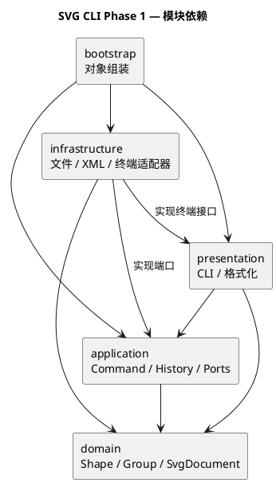

# SVG 编辑器 CLI：Phase 1

需求见 [phase_cli_1.md](../phase_cli_1.md)，仓库为 [software_design_PJ](https://github.com/zhang66678/software_design_PJ)。

## 一、架构方案

### 1. 项目目标

使用 TypeScript 和面向对象方式实现 SVG 命令行编辑器，覆盖本阶段的六种内置类型及文档、编辑、显示、撤销重做命令。`box` 和动态插件属于后续阶段。

### 2. 模块划分

| 目录 | 职责 | 允许依赖 |
| --- | --- | --- |
| `src/domain` | 图形行为、文档树、id 与结构规则 | 本模块，不依赖 CLI、文件或 XML 库 |
| `src/application` | 命令执行、撤销历史、会话及 IO 接口 | domain、本模块 |
| `src/presentation` | 命令解析与显示格式 | application、领域只读接口 |
| `src/infrastructure` | 文件、XML、终端的具体适配 | domain、application 定义的接口、终端接口 |
| `src/bootstrap` | 创建对象、连接各模块并启动 | 上述模块，仅负责组装 |

图形操作和撤销规则与终端、文件系统分离，可以独立验证。

图中箭头表示源码依赖，源文件见 [architecture.puml](architecture.puml)。

### 3. 设计模式选择

- **Command**：将一次编辑封装为命令，让执行与 undo/redo 具有统一入口。
- **Composite**：让容器和叶子图形共享操作接口，容器递归处理子图形。

命令名到实现、图形类型名到类的分派分别集中在命令注册处和图形工厂。这两处是类型与命令扩展的待重构点。

### 4. 变化点假设

| 可能变化 | 扩展准备 |
| --- | --- |
| 增加图形类型 | 集中创建入口，通过多态完成图形行为 |
| 增加 GUI 或其他输入方式 | 命令对象与终端输入分离 |
| 更换 SVG 解析库或存储方式 | 用 IO 接口隔离具体实现 |

### 5. 工程工具

运行环境采用 Node.js 24。TypeScript 使用严格类型检查，以 NodeNext 模块规则编译为原生 ESM；ESLint 使用 [typescript-eslint 推荐配置](https://typescript-eslint.io/getting-started/)，并约束一类一文件及成员的显式访问修饰符。

依赖版本由 `package-lock.json` 锁定，使用 `npm ci` 安装。`src/bootstrap/Main.ts` 为程序入口，`npm run cli` 通过 `precli` 自动构建后启动。

## 质量保证手段

`npm run check` 依次执行类型检查、ESLint 静态检查和编译构建，任一检查失败即停止。

CI 工作流覆盖 Windows 和 Linux，执行 `npm ci`、`npm run check` 和 `npm run cli`，使依赖安装、检查和程序启动使用统一入口。
