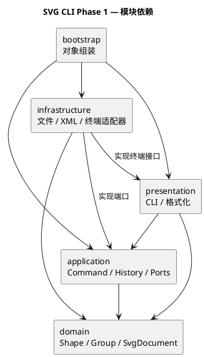

# SVG 编辑器 CLI：Phase 1

需求见 [phase_cli_1.md](../phase_cli_1.md)，仓库为 [software_design_PJ](https://github.com/zhang66678/software_design_PJ)。

## 一、架构方案

### 1. 项目目标

使用 TypeScript 和面向对象方式实现 SVG 命令行编辑器，覆盖本阶段的六种内置类型及文档、编辑、显示、撤销重做命令。`box` 和动态插件属于后续阶段。

### 2. 模块划分

| 目录 | 职责 | 允许依赖 |
| --- | --- | --- |
| `src/domain` | 图形行为、文档树、id 与结构规则 | 本模块，不依赖 CLI、文件或 XML 库 |
| `src/application` | 命令执行、撤销历史、会话及 IO 接口 | domain、本模块 |
| `src/presentation` | 命令解析与显示格式 | application、领域只读接口 |
| `src/infrastructure` | 文件、XML、终端的具体适配 | domain、application 定义的接口、终端接口 |
| `src/bootstrap` | 创建对象、连接各模块并启动 | 上述模块，仅负责组装 |

图形操作和撤销规则与终端、文件系统分离，可以独立验证。

图中箭头表示源码依赖，源文件见 [architecture.puml](architecture.puml)。

### 3. 设计模式选择

- **Command**：一次编辑由 `EditCommand` 封装，通过 `CommandExecutor` 执行；历史记录保存执行前后的快照，统一恢复 undo/redo 的结果。
- **Composite**：让容器和叶子图形共享操作接口，容器递归处理子图形。

撤销恢复采用文档快照（Memento）：图形通过多态克隆保存自身状态，历史机制无需了解具体图形的几何属性。

命令名到实现、图形类型名到类的分派分别集中在命令注册处和图形工厂。这两处是类型与命令扩展的待重构点。

### 4. 变化点假设

| 可能变化 | 扩展准备 |
| --- | --- |
| 增加图形类型 | 集中创建入口，通过多态完成图形行为 |
| 增加 GUI 或其他输入方式 | 命令对象与终端输入分离 |
| 更换 SVG 解析库或存储方式 | 用 IO 接口隔离具体实现 |

### 5. 工程工具

运行环境采用 Node.js 24。TypeScript 使用严格类型检查，以 NodeNext 模块规则编译为原生 ESM；ESLint 使用 [typescript-eslint 推荐配置](https://typescript-eslint.io/getting-started/)，并约束一类一文件及成员的显式访问修饰符。

依赖版本由 `package-lock.json` 锁定，使用 `npm ci` 安装。`src/bootstrap/Main.ts` 为程序入口，`npm run cli` 通过 `precli` 自动构建后启动。

### 6. 领域模型

| 类或接口 | 职责 |
| --- | --- |
| `Shape` | 封装不可变 id 和样式，定义移动、克隆与属性描述接口 |
| `Rect` | 封装矩形几何状态，校验参数并以增量移动位置 |
| `Style` | 校验公共样式，保留属性未设置的状态，输出只读属性 |
| `SvgDocument` | 管理画布、有序根节点、id 唯一校验与查找，通过多态克隆图形 |
| `DomainError` | 表达领域校验失败，不依赖终端输出 |
| `ShapeDescription` | 供显示与序列化使用的只读描述，不承担图形修改行为 |

几何字段使用私有状态和只读访问器，修改通过领域方法完成。矩形位置接受有限浮点数，宽高为非负有限数；画布宽高为正有限数。移动先校验完整目标几何，成功后统一修改，非法输入和数值溢出均不留下部分修改。

属性描述与节点列表返回冻结的副本，调用者不能通过改写这些结果修改内部字段或根节点顺序。克隆使用图形自身的 `clone()`，保留具体类型和行为，原文档与副本的后续修改互不影响。

### 7. 命令执行与撤销历史

| 类 | 职责 |
| --- | --- |
| `EditCommand` | 定义在候选文档上执行一次编辑、返回结果摘要的接口 |
| `CommandExecutor` | 组织候选文档、执行命令并提交结果，提供撤销、重做和历史屏障入口 |
| `EditorSession` | 持有当前文档快照，返回独立文档副本，捕获与恢复会话中的文档状态 |
| `DocumentSnapshot` | 通过深拷贝隔离文档，每次恢复均产生独立对象 |
| `HistoryEntry` | 保存一次编辑前后的快照与摘要，按整个命令恢复状态 |
| `CommandHistory` | 管理撤销栈、重做栈及历史屏障 |
| `ApplicationError` | 表达缺少文档、空历史或撤销重做被禁止等应用规则错误 |

编辑通过 `CommandExecutor.execute()` 统一执行：捕获原快照，克隆出候选文档，让命令在候选文档上完成操作，再构造结果快照。上述准备全部成功后，才替换会话状态并记录历史。命令执行或结果快照生成失败时，原文档、撤销栈、重做栈和屏障状态均保持不变。

一条成功的编辑命令形成一个撤销单元，即使内部修改了多个图形。撤销恢复执行前的快照，重做恢复执行后的快照，不重新执行命令；新的成功编辑清空重做栈。查询只读取会话返回的副本，不进入历史，也不能通过修改副本改变当前文档。

`CommandExecutor.replaceDocument()` 在整体替换文档后清空两个历史栈并设置屏障；`CommandExecutor.setHistoryBarrier()` 保留文档内容并设置相同屏障。屏障期间撤销和重做均报 `undo not allowed after io command`，读取文档和失败编辑不能解除屏障，下一次成功编辑开始新的历史。

快照使用图形自身的 `clone()`，保留具体类型、样式缺省和节点顺序。会话读取结果以及命令保留的候选文档引用都与当前状态隔离。每次编辑需要复制整个文档，历史内存随文档规模与编辑次数增长；这一方案用较直接的实现保证多图形操作的原子性，适合课程项目规模。

## 质量保证手段

`npm run check` 依次执行类型检查、ESLint 静态检查、领域与应用层测试和编译构建，任一检查失败即停止。类型检查同时覆盖源码与测试，构建只输出产品源码。

测试使用 Node.js 内置的 `node:test` 和 `node:assert/strict`。`pretest` 将测试及依赖源码编译到 `.test-dist/`，再由 Node.js 执行测试，编译产物不纳入版本控制。

领域测试覆盖矩形移动、非法几何与数值溢出、只读封装、样式缺省、大小写敏感的 id 唯一性、根节点顺序及深拷贝隔离。测试通过检查完整状态确认失败不改变图形或文档。

应用层测试使用小型测试命令操作真实文档，检查多步编辑的撤销重做顺序、整条命令的恢复粒度、失败前已修改部分候选文档时的原子性、失败保留重做记录、成功新编辑清空重做记录，以及屏障的设置与解除。另通过人为触发克隆失败验证结果快照和文档替换失败时仍保留原状态，并检查外部引用不能污染当前文档或历史。

CI 工作流覆盖 Windows 和 Linux，执行 `npm ci`、`npm run check` 和 `npm run cli`，使依赖安装、检查和程序启动使用统一入口。
