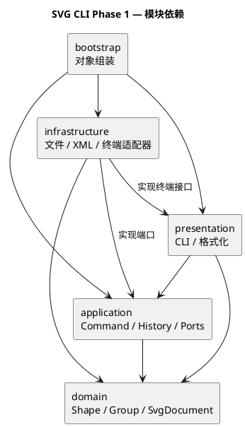

# SVG 编辑器 CLI：Phase 1

需求见 [phase_cli_1.md](../phase_cli_1.md)，仓库为 [software_design_PJ](https://github.com/zhang66678/software_design_PJ)。

## 一、架构方案

### 1. 项目目标

使用 TypeScript 和面向对象方式实现 SVG 命令行编辑器，覆盖本阶段的六种内置类型及文档、编辑、显示、撤销重做命令。`box` 和动态插件属于后续阶段。

### 2. 模块划分

| 目录 | 职责 | 允许依赖 |
| --- | --- | --- |
| `src/domain` | 图形行为、文档树、id 与结构规则 | 本模块，不依赖 CLI、文件或 XML 库 |
| `src/application` | 命令执行、撤销历史、会话及 IO 接口 | domain、本模块 |
| `src/presentation` | 命令解析与显示格式 | application、领域只读接口 |
| `src/infrastructure` | 文件、XML、终端的具体适配 | domain、application 定义的接口、终端接口 |
| `src/bootstrap` | 创建对象、连接各模块并启动 | 上述模块，仅负责组装 |

图形操作和撤销规则与终端、文件系统分离，可以独立验证。

图中箭头表示源码依赖，源文件见 [architecture.puml](architecture.puml)。

### 3. 设计模式选择

- **Command**：应用命令共享 `Command.execute(executor)` 入口；编辑命令继承 `EditCommand`，通过 `CommandExecutor` 执行并记录前后快照，统一恢复 undo/redo 的结果。
- **Composite**：让容器和叶子图形共享操作接口，容器递归处理子图形。

撤销恢复采用文档快照（Memento）：图形通过多态克隆保存自身状态，历史机制无需了解具体图形的几何属性。

命令名到实现、图形类型名到类的分派分别集中在命令注册处和图形工厂。这两处是类型与命令扩展的待重构点。

### 4. 变化点假设

| 可能变化 | 扩展准备 |
| --- | --- |
| 增加图形类型 | 集中创建入口，通过多态完成图形行为 |
| 增加 GUI 或其他输入方式 | 命令对象与终端输入分离 |
| 更换 SVG 解析库或存储方式 | 用 IO 接口隔离具体实现 |

### 5. 工程工具

运行环境采用 Node.js 24。TypeScript 使用严格类型检查，以 NodeNext 模块规则编译为原生 ESM；ESLint 使用 [typescript-eslint 推荐配置](https://typescript-eslint.io/getting-started/)，并约束一类一文件及成员的显式访问修饰符。

依赖版本由 `package-lock.json` 锁定，使用 `npm ci` 安装。`src/bootstrap/Main.ts` 为程序入口，`npm run cli` 通过 `precli` 自动构建后启动。

### 6. 领域模型

| 类或接口 | 职责 |
| --- | --- |
| `Shape` | 封装不可变 id 和样式，定义移动、克隆与属性描述接口 |
| `Rect` / `Circle` / `Ellipse` | 各自封装几何状态，校验参数并以增量移动位置 |
| `Style` | 校验公共样式，保留属性未设置的状态，输出只读属性 |
| `SvgDocument` | 管理画布、有序根节点、id 唯一校验与查找，通过多态克隆图形 |
| `DomainError` | 表达领域校验失败，不依赖终端输出 |
| `ShapeDescription` | 供显示与序列化使用的只读描述，不承担图形修改行为 |

几何字段使用私有状态，修改通过领域方法完成，属性通过只读描述获取。位置接受有限浮点数，矩形宽高、圆半径和椭圆半轴长度为非负有限数；画布宽高为正有限数。移动先校验完整目标几何，成功后统一修改，非法输入和数值溢出均不留下部分修改。

属性描述与节点列表返回冻结的副本，调用者不能通过改写这些结果修改内部字段或根节点顺序。克隆使用图形自身的 `clone()`，保留具体类型和行为，原文档与副本的后续修改互不影响。

### 7. 命令执行与撤销历史

| 类 | 职责 |
| --- | --- |
| `Command` | 定义应用命令的统一执行入口 |
| `EditCommand` | 将编辑交给执行器，通过 `apply()` 修改候选文档并返回结果摘要 |
| `CommandExecutor` | 组织候选文档、执行命令并提交结果，提供撤销、重做和历史屏障入口 |
| `EditorSession` | 持有当前文档快照，返回独立文档副本，捕获与恢复会话中的文档状态 |
| `DocumentSnapshot` | 通过深拷贝隔离文档，每次恢复均产生独立对象 |
| `HistoryEntry` | 保存一次编辑前后的快照与摘要，按整个命令恢复状态 |
| `CommandHistory` | 管理撤销栈、重做栈及历史屏障 |
| `ApplicationError` | 表达缺少文档、空历史或撤销重做被禁止等应用规则错误 |

编辑通过 `CommandExecutor.execute()` 统一执行：捕获原快照，克隆出候选文档，调用编辑命令的 `apply()` 完成操作，再构造结果快照。上述准备全部成功后，才替换会话状态并记录历史。命令执行或结果快照生成失败时，原文档、撤销栈、重做栈和屏障状态均保持不变。

一条成功的编辑命令形成一个撤销单元，即使内部修改了多个图形。撤销恢复执行前的快照，重做恢复执行后的快照，不重新执行命令；新的成功编辑清空重做栈。查询只读取会话返回的副本，不进入历史，也不能通过修改副本改变当前文档。

`CommandExecutor.replaceDocument()` 在整体替换文档后清空两个历史栈并设置屏障；`CommandExecutor.setHistoryBarrier()` 保留文档内容并设置相同屏障。屏障期间撤销和重做均报 `undo not allowed after io command`，读取文档和失败编辑不能解除屏障，下一次成功编辑开始新的历史。

快照使用图形自身的 `clone()`，保留具体类型、样式缺省和节点顺序。会话读取结果以及命令保留的候选文档引用都与当前状态隔离。每次编辑需要复制整个文档，历史内存随文档规模与编辑次数增长；这一方案用较直接的实现保证多图形操作的原子性，适合课程项目规模。

### 8. 应用命令与图形创建

| 命令类 | 行为与历史规则 |
| --- | --- |
| `InitCommand` | 新建空文档，宽高默认 800×600；尺寸校验成功后整体替换文档并设置历史屏障 |
| `CreateCommand` | 通过图形工厂创建图形，加入文档；一次创建形成一个撤销单元 |
| `MoveCommand` | 按 id 查找图形，通过 `Shape.move()` 平移；一次移动形成一个撤销单元 |
| `UndoCommand` | 恢复上一条编辑前的文档，并将记录移入重做栈 |
| `RedoCommand` | 恢复被撤销编辑后的文档，并将记录移回撤销栈 |

调用方以 `Command` 类型持有命令，统一调用 `execute(executor)`。编辑命令由 `EditCommand` 转交事务执行器，文档初始化和撤销重做命令直接调用执行器对应的操作。命令不读取终端或打印输出，成功时返回摘要，失败时抛出异常。

图形类型名到创建器的映射集中在 `ShapeFactory`，代码中标注为待重构点。工厂解析矩形、圆和椭圆的几何参数及可选 fill；`CommandArguments` 校验参数数量并转换有限数值，图形类和 `Style` 负责 id、几何与样式的领域约束。省略 fill 时保留属性缺省，显式空值则校验失败。未知类型按约定报 `unknown shape type: <type> (is the plugin loaded?)`。

`CreateCommand` 保存创建参数的副本，调用方后续修改原参数数组不会影响命令。移动通过图形多态执行，摘要统一报告移动增量，例如 `rect#r1 moved by (30,0)`，无需按图形类型选择移动或反馈逻辑。

### 9. 终端解析与显示

| 类或接口 | 职责 |
| --- | --- |
| `Tokenizer` | 按空白和双引号分词，处理整行注释与引号内转义，不解释命令或图形类型 |
| `CommandRegistry` | 集中命令名分派，校验入口参数并创建命令；从同一份注册信息生成 help |
| `TreeCommand` / `ShowCommand` / `HelpCommand` | 通过统一命令入口返回查询结果，不进入编辑历史 |
| `DocumentFormatter` | 从图形只读描述生成 tree/show 文本，显示几何、显式样式与父节点 |
| `ErrorFormatter` | 将异常转换为一行以 `error:` 开头的信息 |
| `CliLoop` | 顺序读取输入，执行命令、输出结果，捕获单条命令错误并继续，结束时关闭终端 |
| `Terminal` / `NodeTerminal` | presentation 定义终端接口，infrastructure 用 Node.js readline 和流实现读写 |

`Main` 组装会话、事务执行器、图形工厂、命令注册表和终端。执行路径为逐行输入 → Tokenizer → CommandRegistry → Command.execute；编辑通过事务执行器提交，查询读取会话提供的独立副本。命令名分派与图形类型分派分别标注在 CommandRegistry、ShapeFactory 中，显示模块按通用属性描述工作。

空白行和首个非空白字符为 `#` 的整行注释跳过；命令参数中的 `#` 保留为字面内容。双引号保留参数中的空格和空字符串，引号内识别双引号及反斜杠转义，其余反斜杠原样保留。未闭合引号作为当前行的错误处理，不影响后续输入。

交互终端使用 `svg> ` 提示符，支持 `Ctrl+C` 退出。通过管道输入时隐藏提示符，并在 EOF 后正常结束；异步逐行遍历保留缓冲区中的命令顺序，末行没有换行也会执行。正常结果写入标准输出，错误写入标准错误流。

`tree` 内联展示 SVG 属性名与数值，`show` 分行显示几何和样式；省略的样式不补默认属性。包含空格的属性值使用引号显示。使用示例见[根目录 README](../README.md#使用示例)。

## 质量保证手段

`npm run check` 依次执行类型检查、ESLint 静态检查、自动化测试和编译构建，任一检查失败即停止。类型检查同时覆盖源码与测试，构建只输出产品源码。

测试使用 Node.js 内置的 `node:test` 和 `node:assert/strict`。`pretest` 将测试及依赖源码编译到 `.test-dist/`，再由 Node.js 执行测试，编译产物不纳入版本控制。

领域测试覆盖图形移动与克隆、非法几何与数值溢出、只读封装、样式缺省、大小写敏感的 id 唯一性、根节点顺序及深拷贝隔离。测试通过检查完整状态确认失败不改变图形或文档。

应用层测试使用小型测试命令操作真实文档，检查多步编辑的撤销重做顺序、整条命令的恢复粒度、失败前已修改部分候选文档时的原子性、失败保留重做记录、成功新编辑清空重做记录，以及屏障的设置与解除。另通过人为触发克隆失败验证结果快照和文档替换失败时仍保留原状态，并检查外部引用不能污染当前文档或历史。

应用命令测试通过统一入口完成新建、创建、移动、撤销和重做，检查矩形 x 坐标依次为 10、40、10、40；同时验证初始化默认值、重复初始化清除旧历史、失败初始化保留重做记录，以及重复 id、缺少文档、缺少图形、非法参数和移动溢出的失败行为。工厂测试覆盖类型识别、参数数量、浮点数与非有限数值、可选样式和领域校验。

终端测试覆盖分词、中文与带空格参数、Windows 路径、引号转义、整行注释和十六进制色值，以及命令参数校验、错误前缀、只读查询和交互提示符。真实入口集成测试启动独立 Node.js 进程，回放矩形编辑会话、错误后继续输入、中文参数及批量命令；检查完整输出、标准错误、执行顺序和 EOF 退出。

交互终端与 npm 启动的管道输入均回放矩形编辑示例，核对移动、撤销和重做后的属性；交互模式另验证 `Ctrl+C` 正常退出。

CI 工作流覆盖 Windows 和 Linux，执行 `npm ci`、`npm run check` 和 CLI 启动验证；启动验证从标准输入传入 `help` 并在 EOF 后结束，使依赖安装、检查和程序启动使用统一入口。
