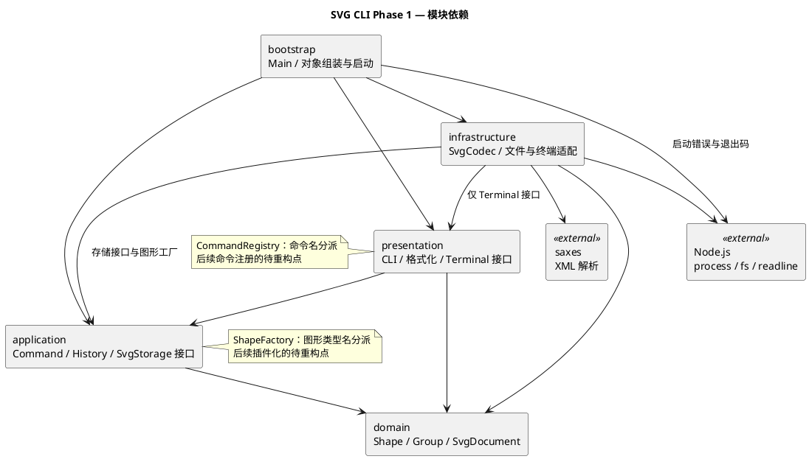

# SVG 编辑器 CLI：Phase 1

[课程需求](../phase_cli_1.md) · [运行与使用](../README.md) · [架构图源文件](architecture.puml)

## 架构方案

### 模块与依赖方向

| 模块 | 职责 | 允许依赖 |
| --- | --- | --- |
| `domain` | 图形行为、有序文档树、几何与 id 约束 | 本模块 |
| `application` | 应用命令、会话、撤销历史及存储接口 | 本模块、domain |
| `presentation` | CLI 解析、显示、错误格式及终端接口 | 本模块、application、domain |
| `infrastructure` | SVG 编解码、文件与终端适配 | 本模块、application、domain；presentation 仅限 Terminal 接口 |
| `bootstrap` | 组装对象、启动程序、处理启动失败与退出码 | 上述模块、Node.js process |

领域层不依赖终端、文件系统或 XML 库，应用层通过接口请求存储，具体适配器由入口注入。presentation 不依赖 infrastructure，实现替换集中在 bootstrap。图中箭头表示源码依赖，包括类型导入。

### 设计模式与核心对象

- **Command**：所有命令通过 `Command.execute(executor)` 执行。创建、移动、缩放、属性和结构编辑继承 `EditCommand`，共用 `CommandExecutor`；查询和文档 IO 也使用统一入口。
- **Composite**：`Group` 与五种叶子类型都继承 `Shape`。移动、缩放、克隆和遍历通过多态完成，命令不区分容器与叶子；文字缩放改变 x/y，不改变字体。
- **Memento**：`DocumentSnapshot` 保存独立文档副本，`HistoryEntry` 持有编辑前后的快照。undo/redo 恢复结果，不重新执行命令。

`Shape` 封装不可变 id 与公共样式，叶子类封装各自几何和文字；`Style` 保留属性未设置的状态。只读描述 `ShapeDescription` 供显示和编码使用，修改行为仍由领域对象承担。

`SvgDocument` 管理画布尺寸、有序根节点及全树 id 唯一性，集中处理查找、父级定位、挂接、摘除、分组和重排。容器子节点列表只读，结构变更通过 `withChildren()` 重建祖先路径；无需另外维护父指针或索引。`Group` 的公共样式保存在组上，由 SVG 继承，保留子节点显式样式。

编辑先在候选文档上执行，再生成结果快照，全部成功后才替换会话并记录历史。一条成功编辑对应一个 undo 单元，失败保留文档、历史及屏障；成功的新编辑清空 redo。整份文档快照会增加复制与内存开销，当前选择适合课程规模的直接实现。

`EditorSession` 同时保存当前快照与默认文件路径。成功 init、read、save 或修改 canvas 尺寸后设置历史屏障；查询不改变历史。read 与显式 save 更新默认路径，init 清除路径，canvas 保留路径，失败 IO 不更新路径或历史。

### SVG 与终端适配

应用层的 `SvgStorage` 接口由 `NodeSvgStorage` 实现，命令保持同步。`SvgCodec` 负责编解码，saxes 仅负责 XML 合法性、命名空间和实体解码；图形还原复用 `ShapeFactory` 的同一份类型定义，不增加按标签名分派的位置。

读取先解析并验证完整候选文档，收集全部显式 id 后，按先序为缺失或空 id 分配“标签名+序号”，避免抢占文件中后续节点的名称。只有替换会话成功后，才返回警告与摘要。保存先完成 XML 编码，再独占创建同目录临时文件并重命名；写入失败时清理本次拥有的临时文件。

读取支持六种内置类型、显式 fill/stroke/stroke-width、有限数或 px 几何值，以及零原点且与画布尺寸一致的 viewBox。未提供的图形几何值按 0 处理。未知元素、transform、CSS、字体属性、DTD 和处理指令明确拒绝；支持范围与[使用说明](../README.md#svg-支持范围)一致，不承诺完整 SVG 标准兼容。

`Tokenizer` 处理注释、双引号和 Windows 路径；`CommandRegistry` 创建命令，并由同一份注册信息生成 help。`DocumentFormatter` 通过通用描述和子节点接口递归输出 tree/show，`ErrorFormatter` 将异常转换为单行 `error:`。`CliLoop` 捕获单条命令错误后继续处理输入，`NodeTerminal` 实现标准流和交互提示符，管道输入在 EOF 后退出。

### 变化点与取舍

| 可能变化 | 当前准备或取舍 |
| --- | --- |
| 新增图形或插件 | Shape 多态接口与统一工厂；ShapeFactory 的硬编码类型表是待重构点，当前不实现 box 或动态加载 |
| 新增命令或输入通道 | Command 与终端分离；CommandRegistry 的硬编码命令表是待重构点，当前不实现插件注册框架 |
| 更换文件适配器或 XML 库 | SvgStorage 隔离存储，SvgCodec 封装 XML；更换解析库只修改基础设施与组装 |
| 大文档或长历史 | 当前递归遍历与完整快照便于验证，暂不增加索引缓存、增量历史或通用场景图框架 |

## 过程记录

保留三项影响最终实现的关键修正：

1. **迁移中的祖先旧引用。** 摘除节点会重建祖先，继续使用旧目标容器可能带回已经摘除的内容。最终在摘除后按 id 重新定位目标，领域测试验证迁入祖先、同父级迁移及原有顺序，应用测试验证 undo 恢复父级与位置。
2. **结果快照也可能失败。** 编辑方法成功不代表整条命令可以提交。执行器先构造结果快照和历史记录，再替换会话；通过主动触发 clone 失败的测试，确认文档、redo 和屏障不被提前改变。
3. **SVG 导入的分派与命名。** 重新按标签分派会重复图形工厂，边读边补 id 又可能抢占后面的显式名称。最终复用工厂元数据，并先收集显式 id 再统一补名；往返测试和后置显式 id 用例验证类型、顺序、样式与名称保持正确。

## 一致性自查

**模块划分：** 实际源码按 domain、application、presentation、infrastructure、bootstrap 五个目录组织，与方案一致。文档树与结构规则位于 domain，文件和 XML 实现在 infrastructure；存储接口位于 application，终端接口位于 presentation。图中的文件适配和工厂依赖已反映最终实现。

**依赖方向：** 对 52 个 TypeScript 源文件的 178 条静态 import 进行检查，模块间依赖与图示一致，未发现违反上述规则的导入。infrastructure 对 presentation 的导入仅为 Terminal 接口；bootstrap 对 node:process 的使用仅用于启动错误输出和退出码。此检查覆盖静态导入，不替代运行时行为测试。

源码共 49 个类，检查确认每文件至多一个类且文件名与类名一致；状态通过私有字段封装。命令名与图形类型名分派仅位于 CommandRegistry、ShapeFactory，并在源码及图中标记为待重构点；显示和 SVG 编码不按图形类型分派。

## 质量保证手段

`npm run check` 依次执行 TypeScript 类型检查、ESLint、测试和构建，失败即停止。源码和测试保留 strict、exactOptionalPropertyTypes、越界访问和 override 等检查；skipLibCheck 用于避开 XML 依赖声明文件的兼容性问题，不关闭项目源码类型检查。ESLint 约束每文件类数量和成员访问修饰符。

自动化测试使用 Node.js 内置 node:test，当前为 **28 组、304 个测试**，覆盖：

- 图形与树：六种类型、嵌套、全树 id 唯一性、几何溢出、分组、迁移、删除、同级顺序和深拷贝隔离。
- 命令与历史：整条命令的 undo/redo、失败原子性、结果快照失败、查询保留历史、成功编辑清空 redo 及 IO 屏障。
- SVG 与文件：中文和 XML 转义、缺省样式、缺 id 避让、坏 XML、重复 id、非法 UTF-8、实际文件读写、默认路径与失败清理。
- 真实 CLI：[第 6 节典型会话](../examples/typical-session.txt)与[第 6.1 节版本 A](../examples/flowchart.txt)直接作为测试输入；结构编辑撤销后与原流程图文件逐字节相同，保存后读回一致，box 按阶段边界拒绝。

依赖由 package-lock.json 锁定，GitHub Actions 配置 Windows 与 Linux 检查，执行 npm ci、npm run check 及 CLI 启动验证。远端通过状态以对应提交的 Actions 记录为准。按[示例回放说明](../README.md#回放课程示例)生成的两个 SVG 已完成视觉检查：典型示例的标题、圆和矩形显示正常，流程图中文无乱码，节点与连接线位置正确。
